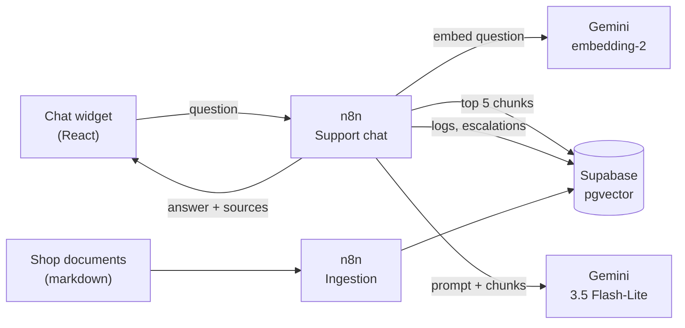

# Maison Nora – French AI customer support assistant

**For business owners:** an assistant that answers your customers' questions in French, day and night, using only your own terms and FAQ, and always shows where the answer comes from. When a question is sensitive or not covered, it hands the conversation over to your team with the customer's email.

> Maison Nora is a **fictional** home-linen shop invented for this demo. All products, policies and contact details are made up.

<!-- Demo GIF: record the widget (question → answer with source → escalation with email) and save it as docs/demo.gif -->


*Demo GIF coming soon. The 2-minute video script is in [docs/video_script.md](docs/video_script.md).*

## Features

- **Answers only from the shop's documents** (10 French policy files: delivery, returns, payment, invoices, account, products…). No invented prices, delays or procedures.
- **Cites its source** under every answer ("Source · Frais de livraison").
- **Hands over to a human** for a specific order, a damaged item, a legal threat, a compensation demand, a request for an advisor, or anything not covered, and collects the customer's email for the team.
- **Remembers the conversation** ("Quel est le délai en France ?" → "et pour la Suisse ?").
- **Resists manipulation** ("ignore tes instructions…") and falls back to a polite message if the AI service is down.
- **Logs every conversation and escalation** in a database, with a confidence score.
- **Embeds on any website** with one `<script>` tag; mobile-friendly and keyboard accessible.
- **Measured, not assumed:** an evaluation script runs 62 customer-style questions and writes a report.

## Architecture



| Layer | Technology |
|---|---|
| Workflows | n8n (self-hosted, Docker Compose) |
| Vector store and logs | Supabase (Postgres + pgvector), Row Level Security on every table |
| AI | Google Gemini API: `gemini-3.5-flash-lite` (answers), `gemini-embedding-2` at 768 dimensions (search) |
| Widget and demo site | React 19, Vite 8, TypeScript |
| Data prep and evaluation | Python 3.11+ (standard library only) |

Full diagrams and design choices: [docs/architecture.md](docs/architecture.md).

## Setup in 10 steps

You need Docker Desktop, Node 20+, Python 3.11+, a free [Supabase](https://supabase.com) project and a free [Gemini API key](https://aistudio.google.com/apikey).

1. **Configure.** Copy `.env.example` to `.env` and fill in `GEMINI_API_KEY`, `SUPABASE_URL`, `SUPABASE_SERVICE_ROLE_KEY` (the `sb_secret_…` key), `SUPABASE_DB_URL` (Session pooler URI) and a random `N8N_ENCRYPTION_KEY`.
2. **Create the database.** In Supabase, open **SQL Editor**, paste [`supabase/migrations/001_init.sql`](supabase/migrations/001_init.sql) and run it. Check with `python scripts/test_supabase.py`.
3. **Start n8n.** `docker compose up -d`, open http://localhost:5678 and create the owner account.
4. **Create three n8n credentials:** *Google Gemini(PaLM) Api* (API key), *Supabase API* (host + secret key) and *Postgres* named "Supabase Postgres" (values from `SUPABASE_DB_URL`, SSL `require`, *Ignore SSL Issues* on).
5. **Import the workflows:**
   ```bash
   docker compose exec n8n n8n import:workflow --input=/workflows/ingest.json
   docker compose exec n8n n8n import:workflow --input=/workflows/chat.json
   ```
6. **Select the credentials** in the HTTP Request, Supabase and Postgres nodes of both workflows, and save.
7. **Load the knowledge base:** open "Ingest knowledge base" and run it from the *Run manually* trigger (expect 10 files, 42 chunks).
8. **Publish "Support chat"** (top-right button), so `/webhook/chat` and `/webhook/escalation-email` are live.
9. **Start the demo shop:** `cd widget && npm install && npm run dev`, then open http://localhost:5173.
10. **Evaluate:** `python scripts/evaluate.py` (about 6 minutes) writes [docs/eval_report.md](docs/eval_report.md).

## Evaluation results

`python scripts/evaluate.py` sends the 62 questions of [`data/eval/questions.jsonl`](data/eval/questions.jsonl) to the live chat webhook (one session per question) and writes [docs/eval_report.md](docs/eval_report.md).

| Metric | First run | After tuning |
|---|---|---|
| Answerable questions answered with the correct source | 41/47 (87 %) | **47/47 (100 %)** |
| Answerable questions containing every key fact | 33/47 (70 %) | **47/47 (100 %)** |
| Answerable questions escalated unnecessarily | 6/47 (13 %) | **0/47 (0 %)** |
| Questions that must go to a human, correctly escalated | 15/15 (100 %) | **15/15 (100 %)** |
| Median / max response time | 2.1 s / 3.2 s | 2.3 s / 8.7 s |

What changed between the two runs (October 2026):

1. **System prompt:** the model now answers "how do I…" questions about an order (cancel, change, track a refund, fix an invoice) with the documented procedure instead of handing them over, and must reuse exact values (amounts, promo codes, section names).
2. **Test set:** 6 key facts written as full sentences (e.g. "L'annulation est gratuite") were reduced to their essential words ("gratuite"), so a correct paraphrase is no longer counted as a miss. Numbers, codes and names are still checked exactly.

3. **Compensation demands:** after step 1, "j'exige un geste commercial de 50 €" got the complaint procedure instead of a hand-over. A rule (`geste commercial`, `dédommag…`, `indemni…`, `exige un remboursement/une réduction…`) and an extra escalation case in the prompt now send these to a human. Because the rule was written after seeing that test question, it was also checked on phrasings outside the test set ("Je veux être dédommagé pour ce retard", "Vous pourriez me faire une petite réduction ?" → escalated; "Comment fonctionne le remboursement ?" → answered).

A perfect score on 62 questions written alongside the knowledge base is a good sign, not a guarantee: real customers will phrase things in ways this set does not cover. The retrieval threshold (0.60) never triggered: answerable questions score 0.70–0.84 and the model's own judgment handles off-topic questions.

## Cost

**Demo: €0.** Everything runs on free tiers: Gemini API free tier, Supabase free plan, n8n self-hosted on your own computer.

**Production estimate for a small shop** (prices checked in October 2026; Gemini prices are in USD):

| Item | Assumption | Per month |
|---|---|---|
| Gemini 3.5 Flash-Lite | 3,000 questions × ~1,800 input + ~150 output tokens ($0.30 / $2.50 per 1M tokens) | ≈ $3 |
| Gemini embedding-2 | 3,000 questions × ~40 tokens ($0.20 per 1M) | < $0.10 |
| Supabase | Pro plan (no pausing, daily backups); the free plan also works for low traffic | $25 (or €0) |
| n8n server | Small VPS (2 GB RAM) with Docker | €5–10 |
| **Total** | | **≈ €10–40** |

On the Gemini free tier, Google may use prompts to improve its products; a paid tier is recommended as soon as real customer data is involved.

## Limitations

- **No access to real orders.** The assistant cannot check an order status or a refund; it hands those over to a human by design.
- **French only**, and only for topics covered by the documents. New topics need a new markdown section and a re-ingestion.
- **Free-tier rate limits.** A burst of simultaneous customers can hit Gemini's limits; the widget then shows a polite fallback and escalates.
- **Rule-based checks are keyword patterns.** Unusual wording of a legal threat or a request for a human relies on the model's judgment.
- **Supabase free projects pause after a week without activity**, and the demo CORS setting only allows `http://localhost:5173`.
- **Escalations are stored, not sent.** Notifying the team (email, Slack, helpdesk) is a next step.
- **Widget size:** the embeddable script bundles React (~74 kB gzipped).

## Technical reference

### Repository layout

| Path | Content |
|---|---|
| `data/knowledge_base/` | 10 French markdown policy files (the single source of truth for shop facts) |
| `data/eval/questions.jsonl` | 62 test questions: 47 answerable (source file + key facts), 15 must escalate |
| `data/raw/` | Downloaded dataset (git-ignored) |
| `scripts/` | Python: dataset download and exploration, KB check, Supabase check, evaluation; `curl/` sample payloads |
| `n8n/workflows/` | `ingest.json`, `chat.json` (no credentials inside) |
| `supabase/migrations/` | SQL schema |
| `widget/` | React demo shop and chat widget |
| `docs/` | Architecture, evaluation report, video script, Upwork entry |

### Chat API

`POST /webhook/chat` with `{ "session_id": "8–64 chars", "message": "max 1000 chars" }` returns
`{ "answer": "…", "sources": [{ "file": "livraison.md", "section": "Frais de livraison" }], "escalated": false }`.

`POST /webhook/escalation-email` with `{ "session_id", "email" }` attaches the email to the latest open escalation of the session (200, 404 if there is none, 400 if the email is invalid).

Sample payloads (UTF-8 files, so accents survive on Windows):

```bash
curl -X POST http://localhost:5678/webhook/chat -H "Content-Type: application/json; charset=utf-8" --data-binary @scripts/curl/1_normal.json
```

The chat pipeline: input validation → last 3 exchanges and open escalation from Postgres → rules (injection, human, legal, compensation, damaged item, order number) → query embedding → `match_documents` top 5 → one Gemini call with a JSON schema → escalate if the model says so, cites no retrieved document, or the best similarity is below 0.60 → logs → response. Details in [docs/architecture.md](docs/architecture.md).

### Ingestion

"Ingest knowledge base" reads `/data/knowledge_base/*.md` (mounted read-only), splits by `## ` section and then into ~800-character chunks with ~100 characters of overlap, embeds them in one `batchEmbedContents` call (768 dims, document prefix), deletes the old rows and inserts the new ones. Re-run it after editing the documents.

### Embed the widget on any website

`cd widget && npm run build:embed` produces one self-contained file, `widget/dist-embed/maison-nora-chat.js`. Host it and add one tag before `</body>`:

```html
<script src="https://your-site.example/maison-nora-chat.js"
        data-webhook-url="https://your-n8n.example/webhook/chat"
        defer></script>
```

| Attribute | Default |
|---|---|
| `data-webhook-url` | `VITE_CHAT_WEBHOOK_URL` at build time |
| `data-email-webhook-url` | the chat URL with `/chat` replaced by `/escalation-email` |

The widget renders in a Shadow DOM, so the host site's CSS cannot change it. Add the client's domain to the *Allowed Origins (CORS)* option of both webhooks. `widget/embed-test.html` loads the script on a page with deliberately aggressive CSS.

### Data preparation scripts

```bash
python scripts/download_bitext.py   # Bitext CSV into data/raw/ (pinned version, checksum verified)
python scripts/explore_bitext.py    # categories and intents with row counts
python scripts/check_kb.py          # every eval question's source file and key facts exist in the KB
python scripts/test_supabase.py     # tables, search function and key enforcement
```

## Data attribution

The list of customer intents used to plan the knowledge base and the evaluation questions comes from the
[Bitext Customer Service Tagged Training Dataset for LLM-based Virtual Assistants](https://huggingface.co/datasets/bitext/Bitext-customer-support-llm-chatbot-training-dataset)
by Bitext Innovations, licensed under the
[Community Data License Agreement – Sharing, Version 1.0 (CDLA-Sharing-1.0)](https://cdla.dev/sharing-1-0/).

The dataset is not redistributed here: `scripts/download_bitext.py` downloads it into the git-ignored `data/raw/` folder. The knowledge base was written from scratch; the evaluation questions are French adaptations of instructions from the dataset, with placeholders replaced.
