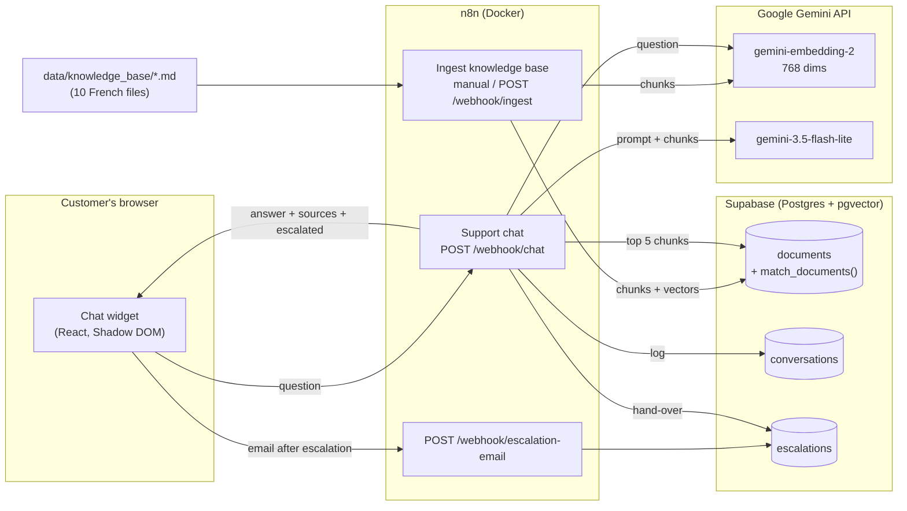
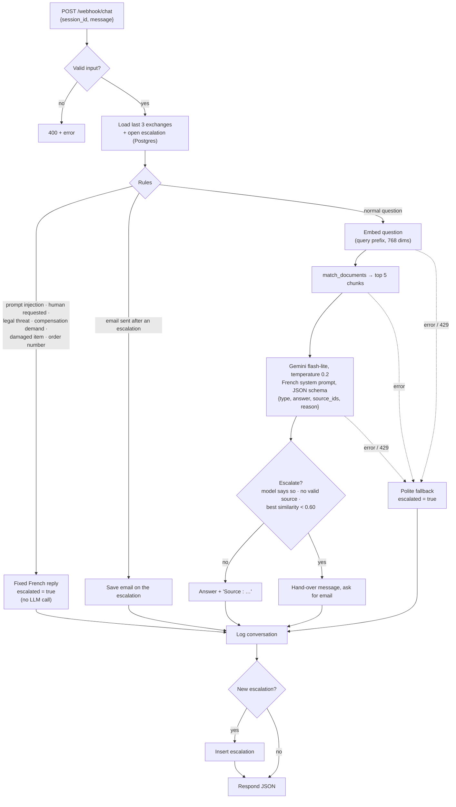
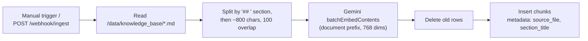

# Architecture

support-bot has three parts: an **ingestion** workflow that turns the shop's documents into searchable chunks, a **chat** workflow that answers customers (or hands them over to a human), and a **widget** that any website can embed.

## Overview

## Chat workflow, step by step

## Ingestion workflow

Old rows are deleted only after every embedding succeeded, so a failed run never empties the store.

## Design choices

| Choice | Why |
|---|---|
| **Fixed pipeline instead of an n8n AI Agent** | Retrieval always runs (an agent may skip its tool), one LLM call per question (free-tier friendly), and the logged `confidence` is a real similarity score. |
| **Rules before the LLM** | Order numbers, requests for a human, legal threats, damaged items and injection attempts are handled instantly, for free and predictably. |
| **Gemini JSON schema** (`responseSchema`) | The model must return `{type, answer, source_ids, reason}`; no fragile text parsing. |
| **Sources checked in code** | The model cites document numbers; only numbers that were really retrieved are kept, and the "Source : …" line is added by code. A made-up source is impossible. |
| **HTTP Request nodes for Gemini** | n8n's built-in Gemini embeddings node cannot set the output size (it returns 3072 dims) or add the `gemini-embedding-2` task prefixes. |
| **768-dimension embeddings** | Smaller index and faster search than 3072, with good quality for short French documents; fits pgvector's HNSW index. |
| **Memory in Postgres** | The last 3 exchanges are read from `conversations`: survives n8n restarts, and the logs double as memory. |
| **Row Level Security, no policies** | The public (publishable) key can read nothing; only the server-side secret key used by n8n has access. |
| **Shadow DOM widget** | The host site's CSS cannot break the widget, and the widget's CSS cannot leak into the site. |

## Data model

| Table | Columns | Written by |
|---|---|---|
| `documents` | `id`, `content`, `metadata` (`source_file`, `section_title`, `doc_title`, `chunk_index`), `embedding vector(768)` | Ingestion |
| `conversations` | `session_id`, `user_message`, `bot_answer`, `sources`, `escalated`, `confidence`, `created_at` | Chat |
| `escalations` | `session_id`, `question`, `reason`, `customer_email`, `status` (`open` / `in_progress` / `closed`), `created_at` | Chat, escalation-email |

Schema: [`supabase/migrations/001_init.sql`](../supabase/migrations/001_init.sql).
